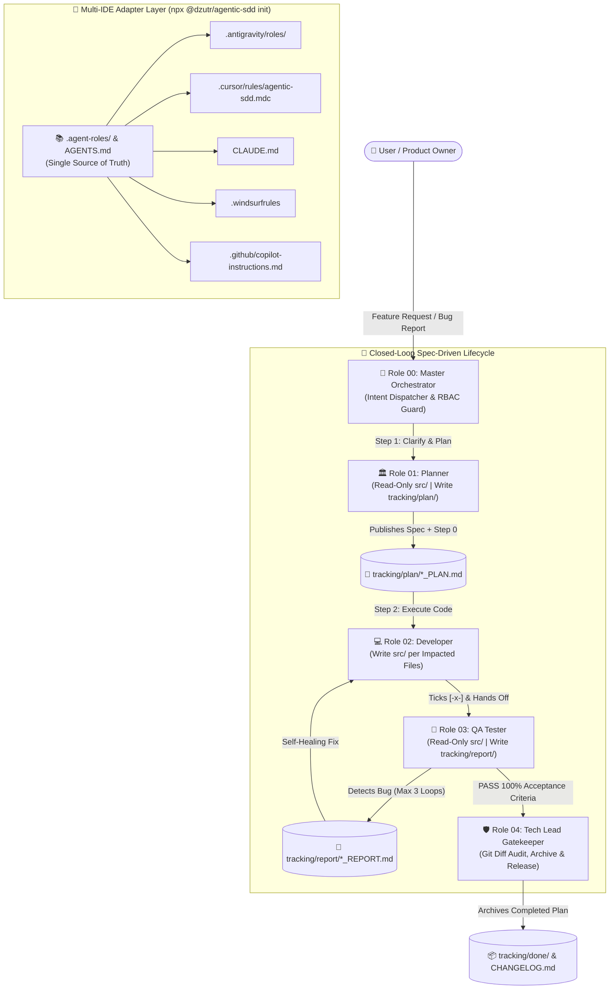

# 👑 Agentic-SDD — Spec-Driven Framework for Autonomous Multi-Agent Teams

> *"The Battle-Tested 4-Role Spec-Driven Framework That Turns AI Coding Assistants Into a Disciplined Engineering Team."*  
> **Zero Dependencies • Multi-IDE Native (Antigravity, Cursor, Claude Code, Windsurf, GitHub Copilot) • Autonomous Self-Healing Loop**

[](./LICENSE)
[](https://nodejs.org/)
[](./package.json)
[](./README.md)

---

## 🚀 1. Why `Agentic-SDD`?

Most AI coding workflows rely on **ad-hoc prompting** or **static specification templates** executed by a single AI persona. While helpful for small prototypes, production software engineering requires **separation of duties, strict tool whitelisting (RBAC), independent QA verification, and an uncompromising release gatekeeper**.

`Agentic-SDD` was forged and battle-tested in commercial production environments (achieving **95–100 Google PageSpeed Insights**, **OWASP Zero-Trust security**, **WCAG 2.2 AA 100/100 accessibility**, and **Edge Serverless reliability**) by synthesizing seven foundational multi-agent engineering pillars into one zero-dependency toolkit:

1. **GitHub Spec-Kit SDD & Explicit Non-Goals:** No spec, no code. Every plan defines strict Non-Goals to prevent scope drift and protect sensitive existing logic.
2. **SOP Artifact Handoffs (Standard Operating Procedures via Markdown):** Every transition between roles produces an immutable, git-tracked Markdown artifact inside `tracking/`.
3. **Strict Role & Tool Whitelisting (RBAC):** Planners and QA Testers are strictly **Read-Only** on application source code (`src/`). Only Developers write production code; only the Tech Lead Gatekeeper archives plans and signs off releases.
4. **Autonomous Self-Healing Loop:** When QA detects a defect, Developer and QA automatically iterate (up to 3 cycles) until 100% of Acceptance Criteria pass—without interrupting the user.
5. **Ruflo Trajectory Bank (Institutional Memory):** Persistent incident memory bank (`tracking/memory/INCIDENT_PATTERNS.md`) prevents repeating platform quirks, command escaping errors, and router drops.
6. **Flash-First Execution Policy (Token Economy):** Default to lighter, ultra-fast models (`flash`) for subagents to save 70%+ token costs, reserving larger models only for complex architectural reasoning.

### 📊 Architectural Comparison: Static Spec Templates vs. `Agentic-SDD`

| Dimension | Ad-Hoc Prompting / Static Spec Templates | `Agentic-SDD` (4-Role Operating Framework) |
| :--- | :--- | :--- |
| **Core Nature** | Static Markdown templates for a single AI | **Full Multi-Agent Operating System** (5 Role Personas, RBAC, CLI, Audit Engine) |
| **Role Separation (RBAC)** | Single-agent bias (same agent writes spec, codes, and self-reviews) | **4 Independent Roles + Master Orchestrator** with strict Read/Write tool whitelisting |
| **Requirement Clarity** | Jumps straight into spec or code generation | **Mandatory Step 0 Clarifications**: Probes 2–3 edge-case questions before planning |
| **Quality Assurance** | Manual human review | **Adversarial Role 03 QA Tester** with 4-Viewport Matrix & automated `verify` CLI |
| **Bug Resolution** | User manually copy-pastes errors back to chat | **Autonomous Self-Healing Loop** (Dev ⇄ QA iterate up to 3 cycles automatically) |
| **Release Protection** | None (AI can overwrite or drift anytime) | **Exclusive Role 04 Tech Lead Gatekeeper** audits `git diff` & archives to `tracking/done/` |
| **Multi-IDE Support** | Single-editor prompt files | **1-Command Bridge** for Antigravity, Cursor, Claude Code, Windsurf & GitHub Copilot |
| **Runtime Footprint** | External runtime or heavy dependencies | **Zero-Dependency Node.js ESM (`"dependencies": {}`)** — executes in `< 100ms` |

---

## 📐 2. System Architecture & Lifecycle



---

## ⚡ 3. Quick Start (Greenfield & Brownfield in 5 Seconds)

### Option A: Initialize in Any New or Existing Project (`init`)
```bash
# Install all 5 roles, tracking/ SOP templates, fullstack-edge preset, and all IDE bridges:
npx @dzutr/agentic-sdd init --preset fullstack-edge --ide all

# Or customize project name, preset, and target directory:
npx @dzutr/agentic-sdd init \
  --target ./my-saas-app \
  --name "AcmeCloud" \
  --preset web-frontend \
  --ide cursor,claude,antigravity
```

> **Safe & Idempotent by Default:** Running `npx @dzutr/agentic-sdd init` on an existing (Brownfield) project **never overwrites** your existing files unless you explicitly pass `--force`.

### Option B: Run Configuration Health Check (`doctor`)
```bash
npx @dzutr/agentic-sdd doctor
```
Verifies that all 5 roles in `.agent-roles/`, all 5 subdirectories in `tracking/` (`plan`, `report`, `task`, `log`, `done`), `AGENTS.md`, IDE adapters, and `scripts/verify-standards.js` are intact (`100% HEALTHY`).

### Option C: Run Automated UI & Spec Standards Audit (`verify`)
```bash
npx @dzutr/agentic-sdd verify
# Or directly via the injected standalone script:
node scripts/verify-standards.js
```
Automatically scans UI source files (`.vue`, `.jsx`, `.tsx`, `.astro`, `.html`, `.css`, `.svelte`) for Web Interface Guidelines compliance (explicit 60 FPS animations, Unicode ellipsis `…`) and verifies that active plans in `tracking/plan/` contain all required SOP sections.

---

## 🧩 4. Available Presets (`--preset`)

| Preset Name | Ideal Use Case | Built-In Guardrails |
| :--- | :--- | :--- |
| `web-frontend` | React, Vue, Astro, Next.js, Svelte UI apps | Core Web Vitals (CLS = 0), WCAG 2.2 AA, 4 Standard Viewports (`430px` ➔ `1440px+`), 60 FPS animations |
| `fullstack-edge` | Fullstack SSR/SSG + Serverless Edge Workers + SQL/NoSQL | OWASP Zero-Trust server recalculation, Edge bundle code-splitting, CDN cache rules + 4 Viewports |
| `backend-api` | Node.js, Go, Python, Rust APIs & Microservices | Strict schema validation, idempotency keys, parameterized queries, migration hygiene |
| `generic` | CLI tools, Desktop apps, Libraries, Data pipelines | Universal Spec-First workflow, Zero Scope Drift, defensive error handling |

---

## 👥 5. Deep Dive: The 4 Roles & Master Orchestrator

- **👑 Role 00 — Master Orchestrator (`.agent-roles/00-orchestrator.md`):** Classifies user intent (`Scenario A: End-to-End Feature`, `Scenario B: Direct @role Invocation`, `Scenario C: Bug-Hunting`), enforces RBAC tool whitelisting, and drives the Self-Healing Loop (up to 3 iterations).
- **🏛️ Role 01 — System Architect & Planner (`.agent-roles/01-planner.md`):** Proactively asks 2–3 edge-case clarification questions (**Step 0 Clarifications**) before authoring `tracking/plan/<FEATURE>_PLAN.md`. Strictly **Read-Only** on `src/`.
- **💻 Role 02 — Software Engineer / Developer (`.agent-roles/02-developer.md`):** Executes code strictly within the `Impacted Files` table (Zero Scope Drift), adheres to Web Interface Guidelines, runs build/test suites, and updates `- [x]` checklists.
- **🧪 Role 03 — QA & Verification Engineer (`.agent-roles/03-tester.md`):** Conducts adversarial boundary testing and 4-Viewport responsive audits (`430px`, `768px`, `1024px`, `1440px+`), publishing structured reports in `tracking/report/`. Automatically triggers the **Self-Healing Loop** with Role 02 when defects are found.
- **🛡️ Role 04 — Strict Tech Lead & Gatekeeper (`.agent-roles/04-reviewer.md`):** Audits `git diff` across 5 mandatory release gates, signs off using `_GATEKEEPING_TEMPLATE.md`, archives completed plans to `tracking/done/`, and updates `tracking/log/CHANGELOG.md`.

---

## 📂 6. End-to-End Walkthrough Example

Explore [`examples/walkthrough-feature/`](./examples/walkthrough-feature/) for a complete, realistic lifecycle trace of a **Webhook Retry & Exponential Backoff** feature:
1. [`01_SAMPLE_PLAN.md`](./examples/walkthrough-feature/01_SAMPLE_PLAN.md) — Authored by **Role 01 (Planner)** with Step 0 Clarifications, Mermaid sequence diagram, and Impacted Files.
2. [`02_SAMPLE_QA_REPORT.md`](./examples/walkthrough-feature/02_SAMPLE_QA_REPORT.md) — Authored by **Role 03 (QA Tester)** demonstrating **Iteration 1 (`🔴 FAIL` — 2 bugs found)** ➔ Developer Self-Healing Fix ➔ **Iteration 2 (`🟢 PASS 100%`)**.
3. [`03_SAMPLE_GATEKEEPING_SIGNOFF.md`](./examples/walkthrough-feature/03_SAMPLE_GATEKEEPING_SIGNOFF.md) — Authored by **Role 04 (Tech Lead Gatekeeper)** auditing the 5 release gates and archiving the plan.

---

## 🔑 7. Standalone Repository Export & Multi-Account Git Setup

To export `packages/agentic-sdd` into a standalone Git repository (e.g., `C:\Users\User\Documents\agentic-sdd`) and commit under a dedicated open-source GitHub identity without altering your global Git configuration (`--global`):

### Step 1: Run the Standalone Exporter
```bash
node packages/agentic-sdd/scripts/export-standalone-repo.js --out "C:/Users/User/Documents/agentic-sdd"
```

### Step 2: Configure Local Git Identity (Per-Repository Scope)
```powershell
cd C:\Users\User\Documents\agentic-sdd
git init -b main
git config user.name "Your OpenSource Username"
git config user.email "your-opensource-email@example.com"
git add .
git commit -m "feat: initial release of Agentic-SDD v1.0.0"
```

### Step 3: Multi-Account SSH Host Alias (Optional)
Add a dedicated host entry to `~/.ssh/config`:
```ssh
Host github.com-opensource
    HostName github.com
    User git
    IdentityFile ~/.ssh/id_ed25519_opensource
```
Then link your remote repository and push:
```powershell
git remote add origin git@github.com-opensource:your-username/agentic-sdd.git
git push -u origin main
```

---

## 📄 License

Released under the [MIT License](./LICENSE).
