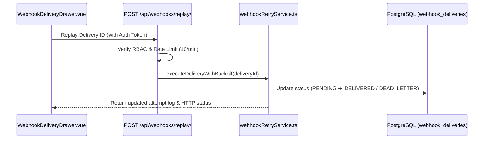

# 📋 WEBHOOK RETRY QUEUE & STATUS DRAWER — TECHNICAL SPECIFICATION (PLAN)

> **Stage / Sprint:** Stage 04 / Sprint 12  
> **Project:** `CloudPulse SaaS` (`Fullstack TypeScript + Edge Workers + PostgreSQL`)  
> **Created Date:** 2026-11-04  
> **Author:** Role 01 (System Architect & Product Planner)  
> **Status:** ✅ Completed (Archived to `tracking/done/`)  
> **Related Docs:** [`02_SAMPLE_QA_REPORT.md`](./02_SAMPLE_QA_REPORT.md), [`03_SAMPLE_GATEKEEPING_SIGNOFF.md`](./03_SAMPLE_GATEKEEPING_SIGNOFF.md)

---

## 0. ❓ CLARIFICATIONS & EDGE CASES
*(Locked in with Product Owner prior to implementation)*
- **Question 1 (Retry Backoff Strategy):** When a customer webhook endpoint returns HTTP `5xx` or times out (`> 5000ms`), how many retries and what backoff schedule should be used?
  - ➔ **Locked Decision (`✅ Approved`):** **Exponential backoff with jitter across 3 attempts (`10s`, `60s`, `300s`)**, then transition status to `DEAD_LETTER` and allow manual 1-click replay from the dashboard.
- **Question 2 (Replay Authorization & Rate Limit):** Who can trigger manual webhook replays and how do we prevent replay storms?
  - ➔ **Locked Decision (`✅ Approved`):** Restrict manual replay to `ADMIN` and `DEVELOPER` roles on the server side, capped at `10 replays / minute / workspace`.

---

## 1. 🎯 GOAL & ARCHITECTURE
- **Core Problem Statement:** Transient network failures cause customer webhook deliveries to drop without visibility or self-service recovery.
- **Key Deliverables:**
  - Automated exponential backoff retry worker (`src/services/webhookRetryService.ts`).
  - Manual replay endpoint (`POST /api/webhooks/replay/`) with server-side RBAC & rate limiting.
  - Responsive Webhook Delivery Drawer (`src/components/WebhookDeliveryDrawer.vue`) across all 4 standard viewports.

### 📐 Architecture & Data Flow Diagram

---

## 2. 🔍 SCOPE

### ✅ In-Scope:
- Exponential backoff engine (max 3 attempts) with jitter and `5000ms` timeout per attempt.
- Server-side RBAC validation and rate-limiting on `POST /api/webhooks/replay/`.
- Responsive slide-over drawer displaying attempt timestamps (`tabular-nums`), status badges, and replay button.

### ❌ Out-of-Scope:
- Custom customer-defined retry intervals (scheduled for Stage 05).
- Webhook payload transformation scripts.

---

## 3. 📝 ACTION ITEMS CHECKLIST

### Phase 1: Backend Retry Service & API Endpoint
- [x] **Task 1.1:** Implement `executeDeliveryWithBackoff` in `src/services/webhookRetryService.ts` with 3-attempt exponential backoff and `AbortSignal.timeout(5000)`.
- [x] **Task 1.2:** Create `src/routes/webhookReplayRouter.ts` enforcing `ADMIN`/`DEVELOPER` role check and 10 req/min sliding-window rate limit.

### Phase 2: Responsive UI Drawer
- [x] **Task 2.1:** Build `src/components/WebhookDeliveryDrawer.vue` with `overscroll-contain`, explicit `transition-transform duration-200`, Unicode ellipsis `Replaying…`, and `tabular-nums` latency metrics.
- [x] **Task 2.2:** Ensure mobile filter search input uses `text-base sm:text-sm` (`16px`) and action buttons include `whitespace-nowrap shrink-0 min-h-[44px]`.

### Phase 3: Verification & Standards Compliance
- [x] **Task 3.1:** Verify responsive layout across Mobile (`430px`), Tablet (`768px`/`1024px`), and Desktop (`1440px+`).
- [x] **Task 3.2:** Run `npm run build`, `npm test`, and `npx agentic-sdd verify` with 0 violations.
- [x] **Task 3.3:** Sync progress in `tracking/task/DAILY_TASKS.md` and `tracking/log/CHANGELOG.md`.

---

## 4. 📂 IMPACTED FILES

| Action | File Path | Description of Changes |
| :---: | :--- | :--- |
| `[Create]` | `src/services/webhookRetryService.ts` | Exponential backoff retry logic & status persistence |
| `[Create]` | `src/routes/webhookReplayRouter.ts` | Authenticated replay API endpoint with rate limiting |
| `[Create]` | `src/components/WebhookDeliveryDrawer.vue` | Responsive inspection & manual replay slide-over drawer |
| `[Create]` | `tests/webhookRetry.test.ts` | Unit & boundary tests for backoff and rate limiting |

---

## 5. 🎯 ACCEPTANCE CRITERIA

1. **Functional & Boundary Integrity:**
   - [x] Retries failed `5xx` deliveries up to 3 times before marking `DEAD_LETTER`.
   - [x] Rejects unauthorized `VIEWER` replay requests with `HTTP 403 Forbidden`.
   - [x] Rejects replay requests exceeding 10/min with `HTTP 429 Too Many Requests`.

2. **Performance, Security & Web Interface Guidelines:**
   - [x] Uses explicit `transition-colors` and `transition-transform` (0 generic catch-all transitions).
   - [x] Uses Unicode ellipsis `…` (`Replaying…`, `Filtering logs…`) and `tabular-nums` for HTTP status codes and durations.

3. **4-Viewport Responsive Matrix:**
   - [x] Zero horizontal overflow or button text wrapping across Mobile (`430px`), Tablet (`768px` / `1024px`), and Desktop (`1440px+`).

4. **Build & Automated Verification:**
   - [x] `npm run build`, `npm test`, and `npx agentic-sdd verify` succeed with exit code `0`.

---

## 6. 🔄 AUTO-ARCHIVE RULE

> [!IMPORTANT]
> **Exclusive to Role 04 (Tech Lead Gatekeeper):** All checklist items are `- [x]` and QA has signed off 100% PASS. Archived to `tracking/done/`.
