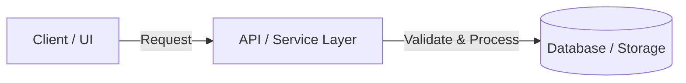

# 📋 [FEATURE / INITIATIVE NAME] — TECHNICAL SPECIFICATION (PLAN)

> **Stage / Sprint:** [e.g., Stage 01 / Sprint 4]  
> **Project:** `{{PROJECT_NAME}}` (`{{TECH_STACK}}`)  
> **Created Date:** YYYY-MM-DD  
> **Author:** Role 01 (System Architect & Product Planner)  
> **Status:** ⏳ Planning / 🔄 In Progress / ✅ Completed  
> **Related Docs:** [Links to PRD / Issue / Mockup / Schema]

---

## 0. ❓ CLARIFICATIONS & EDGE CASES
*(Record the multiple-choice questions and architectural decisions locked in with the Product Owner / User before authoring this plan)*
- **Question 1 (Business Logic / Boundary Case):** [Describe ambiguity] ➔ **Locked Decision (`✅ Approved`):** [Selected option & rationale]
- **Question 2 (Architecture / UX Trade-off):** [Describe trade-off] ➔ **Locked Decision (`✅ Approved`):** [Selected option & rationale]

---

## 1. 🎯 GOAL & ARCHITECTURE
- **Core Problem Statement:** [Concise description of the user pain point or technical bottleneck]
- **Key Deliverables:**
  - [Deliverable 1: Specific, measurable outcome]
  - [Deliverable 2: Performance, security, or UX improvement]

### 📐 Architecture & Data Flow Diagram

---

## 2. 🔍 SCOPE & EXPLICIT BOUNDARIES

### ✅ In-Scope:
- [Feature A: End-to-end data flow and state management]
- [UI Component B: Views, modals, and responsive states]
- [API / Schema C: Endpoints, validation rules, and migrations]

### ⛔ Explicit Non-Goals (Hàng Rào An Toàn Bất Biến — What This Feature WILL NOT Do):
> [!WARNING]
> The following items are STRICTLY FORBIDDEN from being touched, modified, or implemented in this plan. Any deviation will cause Role 04 (Gatekeeper) to immediately reject the release:
- **Non-Goal 1:** [e.g., Do NOT implement K80 receipt printing or sticker generation]
- **Non-Goal 2:** [e.g., Do NOT modify core pricing algorithms outside the approved scope]
- **Non-Goal 3:** [e.g., Do NOT introduce breaking changes to database schemas without explicit migrations]

### ❌ Out-of-Scope (Future Enhancements):
- [Items explicitly deferred to future stages to prevent Scope Creep]
- [Unrelated refactoring outside the Impacted Files table]

---

## 3. 📝 ACTION ITEMS CHECKLIST

### Phase 1: Data Model, Schema & Core Logic
- [ ] **Task 1.1:** [Detailed implementation step]
- [ ] **Task 1.2:** [Detailed implementation step]

### Phase 2: UI Components & API Integration
- [ ] **Task 2.1:** [Detailed implementation step]
- [ ] **Task 2.2:** [Detailed implementation step]

### Phase 3: Verification & Standards Compliance
- [ ] **Task 3.1:** [Verify responsive layout across 4 viewports: Mobile 430px, Tablet 768px/1024px, Desktop 1440px+]
- [ ] **Task 3.2:** [Run `{{BUILD_COMMAND}}`, `{{TEST_COMMAND}}`, and `npx @dzutr/agentic-sdd verify`]
- [ ] **Task 3.3:** [Sync progress in `tracking/task/DAILY_TASKS.md` and `tracking/log/YYYY-MM-DD.md`]

---

## 4. 📁 IMPACTED FILES

| Action | File Path | Description of Changes |
| :---: | :--- | :--- |
| `[Create]` | `src/components/…` | Primary interactive UI component |
| `[Modify]` | `src/pages/…` | Page route integrating the component |
| `[Modify]` | `src/services/…` | Service layer / API handler |

---

## 5. 🎯 ACCEPTANCE CRITERIA

A feature is only ready for release when **100%** of the following criteria pass:

1. **Functional & Boundary Integrity:**
   - [ ] Works accurately per the Goal section with zero unhandled exceptions (`null`/`undefined`/`NaN`).
   - [ ] Gracefully handles empty states, invalid inputs, and network timeouts.
   - [ ] Strictly adheres to all items in **Explicit Non-Goals** (Zero Scope Drift).

2. **Performance, Security & Web Interface Guidelines:**
   - [ ] Zero generic catch-all transitions; uses explicit `transition-colors` / `transition-transform`.
   - [ ] Uses Unicode ellipsis `…` (`&hellip;`) and `tabular-nums` for numeric displays.
   - [ ] Server-side validation enforced (OWASP Zero-Trust).

3. **4-Viewport Responsive Matrix:**
   - [ ] Zero horizontal overflow or button text wrapping across Mobile (`430px`), Tablet (`768px` / `1024px`), and Desktop (`1440px+`).

4. **Build & Automated Verification:**
   - [ ] `{{BUILD_COMMAND}}` and `{{TEST_COMMAND}}` succeed with exit code `0`.

---

## 6. 🔄 AUTO-ARCHIVE RULE

> [!IMPORTANT]
> **Exclusive to Role 04 (Tech Lead Gatekeeper):** Once **all `- [ ]` items in this file are ticked `- [x]`** and Role 03 (Tester) has signed off with 100% PASS:
> 1. Move this file from `tracking/plan/` to `tracking/done/`.
> 2. Update the task status in `tracking/task/DAILY_TASKS.md` to `✅ [Completed Today]`.
> 3. Record the release entry under `[Added]` / `[Changed]` in `tracking/log/CHANGELOG.md`.
